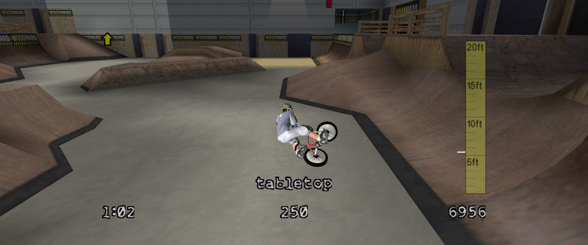
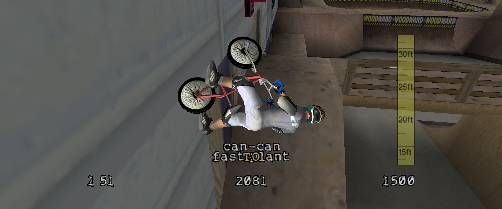
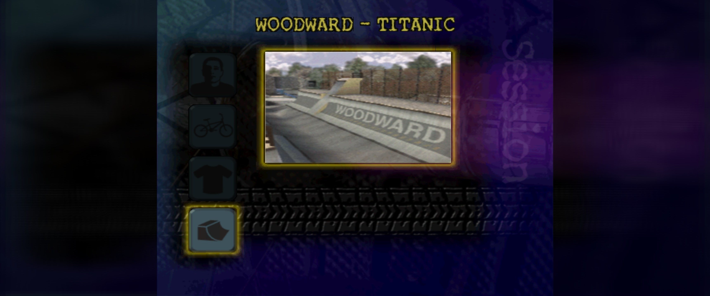
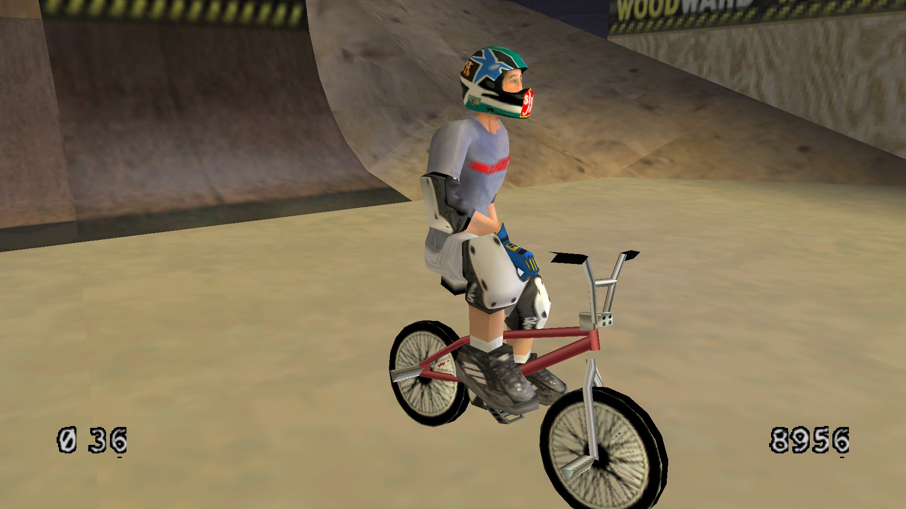

# Open Freestyle BMX

A native, open-source port of the 2000 PC BMX game *Dave Mirra Freestyle BMX*: rebuilt from the ground up for
today's Windows PCs and Android handhelds, at any resolution and frame rate.



<p>
  
  
</p>
<p>
  
</p>

*At 3440×1440 (21:9) and at 1920×1080, the AYN Thor's screen resolution.*

## What you need

- **The PC version of the game**, installed or copied from your own disc. This project contains none of the
  game's files (models, textures, levels, sounds, music, movies): it reads them from your copy.
- **Windows 10 or 11 (64-bit)**, or an **Android 8+ handheld or phone** with an arm64 processor and Vulkan
  (tested on the AYN Thor). On **Linux** (x86-64) you build it yourself; see [Linux](#linux).

## Install

**Windows**

1. Download `OpenFreestyleBMX-<version>-windows-x64.zip` from the [Releases](../../releases) page and unzip it anywhere.
2. Run `OpenFreestyleBMX.exe`. The first time, it asks for your game folder (the one with `Scene.Txt` and the
   `Assets` folder in it) and remembers it. You can also copy the two files into the game folder and run it
   from there.

Windows may warn that the program is from an unknown publisher (it is not signed). Choose *More info*, then
*Run anyway*.

**Android**

1. Copy your game folder to the device (for example into `Download`).
2. Install `OpenFreestyleBMX-<version>-android.apk` from the [Releases](../../releases) page.
3. Start it and choose the game folder. It is copied into the app once (about 250 MB); after that the copy in
   `Download` can go.

**Linux**

There is no Linux download: distributions differ too much for one binary, and the build takes a few minutes. Build
it as described under [Linux](#linux) below, then run `build/linux/OpenFreestyleBMX` from anywhere. The first time
it asks for your game folder (the one with `Scene.Txt` and the `Assets` folder in it) and remembers it in
`OpenFreestyleBMX.ini`; you can also start it from inside the game folder, or set `[general] game_dir` in the ini
by hand if the folder dialog does not open on your desktop. Case does not matter in the game folder.

Saves live in the game folder's `save` folder, as in the original, so a save from the PC works on Android and
the other way around.

## Settings

The first start writes `OpenFreestyleBMX.ini` next to the program (on Android: in the app's files folder,
`Android/data/org.openfreestylebmx.app/files`). Every setting is listed there with an explanation; remove the
`;` at the start of a line to change it. The ones most people want:

| Setting | Default | |
|---|---|---|
| `[video] width`, `height` | 0 | the screen's size; any resolution works |
| `[video] fullscreen` | 1 | 0: a window |
| `[video] interpolate` | 1 | smooth motion at your display's refresh rate; 0: the original 30 frames per second |
| `[video] hud` | 1 | the HUD at the screen's edges on wide screens; 0: in the 4:3 middle |
| `[general] vanilla` | 0 | 1: the original game's look and behaviour for everything you don't set yourself |
| `[audio] mute` | 0 | 1: no sound |
| `[audio] music_dir` | | a folder with your own copies of the soundtrack as FLAC files (below) |

**Controllers:** Xbox and PlayStation controllers work as they did in the original; other pads (like a
handheld's built-in controls) are laid out by position like a PlayStation pad: bottom button jumps, Start opens
the menu. The keyboard works as in the original.

**Music in CD quality:** the game stores its soundtrack as compressed mono. With `[audio] music_dir` pointing at
a folder with the album tracks as FLAC files, it plays them instead, cut exactly like the game's own edits, in
stereo. See [docs/MUSIC.md](docs/MUSIC.md).

## What's different from the original

This is not a patched copy of the original program, and not a machine translation of it. The game's ~3,000
functions were rewritten as readable C, and verified against the original executable: a harness runs the
rewritten code and the original side by side in an emulator, on close to 3,000 test cases, and they must give
identical results down to the last bit of floating point. On top of that faithful base:

- **Modern systems, no compatibility layers.** DirectX 6, DirectInput, DirectSound and the old Windows APIs are
  replaced by [SDL3](https://libsdl.org): Direct3D 12 or Vulkan underneath, current controllers, current audio.
- **64-bit, and on ARM.** The game ran only as a 32-bit x86 program. It now builds for x86-64 and arm64; its
  floating point behaviour is reproduced exactly, so a recorded ride plays out identically on a PC and an
  Android handheld.
- **Any resolution and aspect ratio**, ultrawide included: the 3D view widens instead of stretching, the HUD sits
  at the screen's edges, menus and movies keep their shape, and 2D graphics stay sharp.
- **High frame rates.** The game logic keeps its original 30 updates per second (so the riding feels exactly
  the same), and the picture is interpolated in between up to your display's refresh rate.
- **Full draw distance** instead of the original's pop-in, and your own music in CD quality.
- **Everything optional:** `vanilla = 1` gives the original's look and behaviour.

## Status

The first release is in preparation. Windows (64-bit) and Android are the targets; Linux builds from source
(above), and macOS builds too. Problems and questions: [Issues](../../issues). If the game crashes, attach `OpenFreestyleBMX.log`
from next to the program (on Android, from the app's files folder).

## For developers

How the port works, the verification harness and the build: [docs/NATIVE.md](docs/NATIVE.md),
[docs/PORTING.md](docs/PORTING.md), [docs/PLATFORM.md](docs/PLATFORM.md), [CONTRIBUTING.md](CONTRIBUTING.md) and
[PLAN.md](PLAN.md); the session handover is in [docs/HANDOFF.md](docs/HANDOFF.md).

```sh
cmake --preset native64 && cmake --build --preset native64   # Windows x64 (llvm-mingw, SDL3)
cmake --preset linux && cmake --build --preset linux         # Linux x86-64 (clang, the distribution's SDL3)
android/build.sh                                             # Android (NDK r29, SDL3 source)
tools/check.sh                                               # format, lint, differential tests
```

### Linux

The build needs **clang** (GCC is not supported: the sources use clang's pragmas and warning names; CMake stops
with a message if it finds another compiler), **CMake 3.28 or newer**, **Ninja**, **Python 3** and the
**SDL3 development package**:

| Distribution | Packages |
|---|---|
| Arch, CachyOS, Omarchy | `sudo pacman -S clang cmake ninja python sdl3` |
| Fedora 42 or newer | `sudo dnf install clang cmake ninja-build python3 SDL3-devel` |
| Debian 13, Ubuntu 25.04 or newer | `sudo apt install clang cmake ninja-build python3 libsdl3-dev` |
| NixOS or Nix | `nix develop` in the repository (everything, SDL3 included) |

Older Debian and Ubuntu releases have no SDL3 package: build [SDL3](https://github.com/libsdl-org/SDL/releases)
from source and pass its prefix with `-DSDL3_DIR=<prefix>/lib/cmake/SDL3`. Nix users on a distribution other
than NixOS: a build from `nix develop` links nix's SDL3 and Vulkan loader, which cannot use the system's GPU
driver, so the game stops with "No supported SDL_GPU backend found"; to play, build with the distribution's
packages instead (on NixOS the nix build runs as is). Then:

```sh
git clone https://github.com/DenzoNL/open-freestyle-bmx.git && cd open-freestyle-bmx
cmake --preset linux && cmake --build --preset linux    # build/linux/OpenFreestyleBMX
build/linux/OpenFreestyleBMX                             # asks for the game folder; or start it from the game folder
```

The preset builds with `-Werror`, like the release builds. If a newer clang stops the build on a warning,
add `-DBMX_WERROR=OFF` to the configure command; a plain `cmake -B build` (no preset) also builds the native
executable, without `-Werror`, as long as `CC=clang`. A game folder taken from a Windows install has the right
layout; the CD's `data1.cab` extracted with `unshield` does not (its levels sit in `Level_-_XX` folders): see
"Game folder layout" in [docs/PORTING.md](docs/PORTING.md).

## Legal

Open Freestyle BMX is an independent fan project, not affiliated with or endorsed by the game's publisher or
developer. It contains none of the game's files; you need your own copy of the game. The source includes the
original program's built-in text and tables (menu strings, physics and scoring tables), which the rewritten code
needs to behave identically. The names of the game and its soundtrack belong to their owners.

The source code is released under the [MIT licence](LICENSE).
